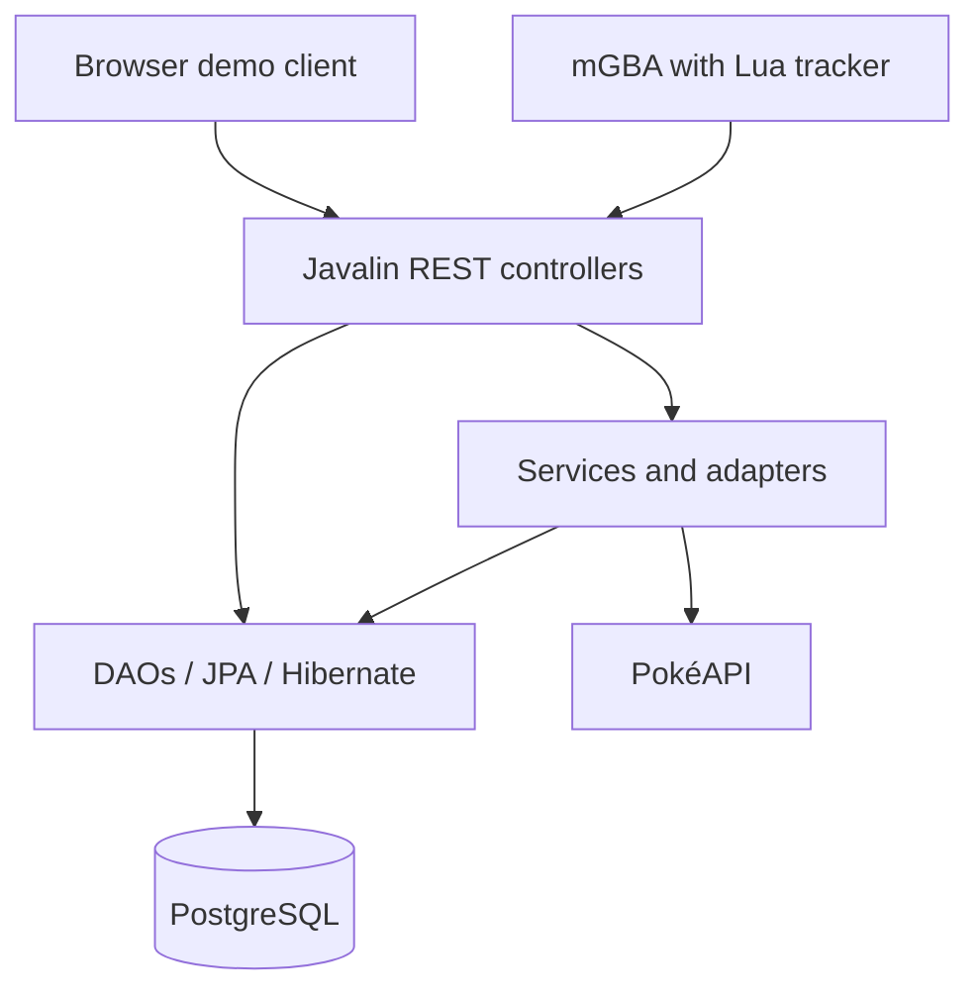
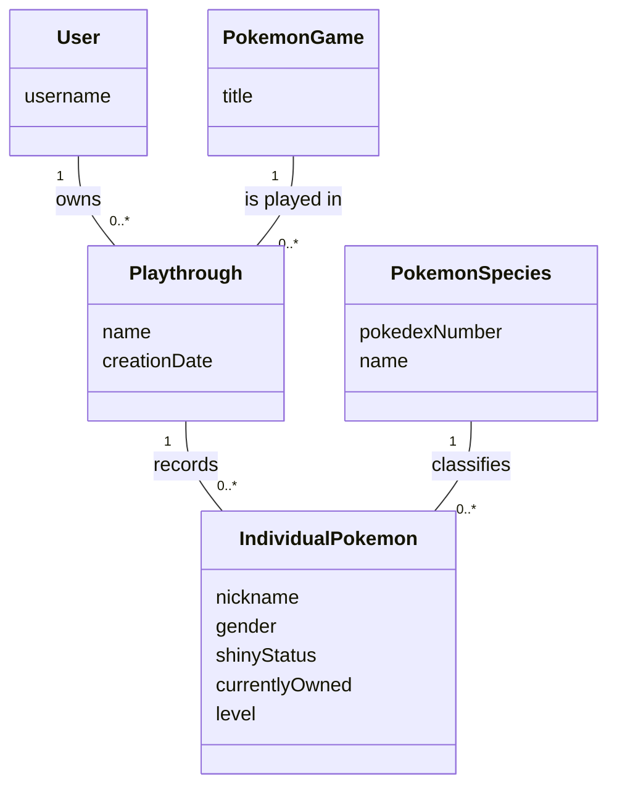
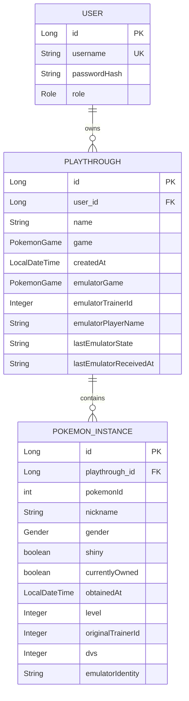

# PokéJourney

## Vision

PokéJourney is a backend API for tracking Pokémon playthroughs, individual Pokémon and collection progress. An mGBA Lua bridge can automatically import data from English Pokémon Red and Blue, while PokéAPI provides Pokémon information and encounter data.

---

## Links

- Portfolio website: [Semester portfolio](https://fabian-str.github.io/Portfolio-3.-semester-2026/)
- Deployed application: Not deployed; see Deployment below.
- Source code repository: [GitHub repository](https://github.com/Fabian-str/3.-semester-backend-project)

---

# Architecture

## System Overview

The backend separates HTTP handling, business logic and database access:

- **Controllers** handle REST requests, validate input and return responses.
- **Services** prepare imported Pokémon, manage emulator connections, handle JWTs and retrieve external data.
- **DAOs** use JPA/Hibernate for database queries and transactions.
- **Entities** represent persistent users, playthroughs and individual Pokémon.
- **DTOs** represent API requests, responses and external API data.
- **Adapters** translate Generation I internal species IDs and map IDs into application data.

Some controllers call DAOs directly for CRUD operations; services are used where additional logic is needed.

Technologies used:

- Java, Maven and Lombok
- Javalin 6.7.0
- Jakarta Persistence / Hibernate and PostgreSQL
- JWT authentication and BCrypt password hashing
- Jackson for JSON
- JUnit 5 and REST Assured
- PokéAPI and mGBA Lua scripting
- HTML, CSS and JavaScript for a simple demonstration client

## Project Structure

The following tree shows the main source directories. Generated files and local configuration are omitted.

```text
backend_project/
|-- README.md
|-- pom.xml                         # Maven dependencies and build configuration
|-- Dockerfile
|-- docker-compose.yml
|-- .env.example                    # Template for local Compose variables
`-- src/
    |-- main/
    |   |-- java/app/
    |   |   |-- Main.java           # Application entry point
    |   |   |-- adapters/           # Translation of Generation I data
    |   |   |-- api/                # REST controllers
    |   |   |-- concurrency/        # Runnable demonstration
    |   |   |-- config/             # Configuration and dependency construction
    |   |   |-- dao/                # DAO interfaces and implementations
    |   |   |-- dto/                # Request and response data
    |   |   |   `-- pokeapi/        # External PokéAPI DTOs
    |   |   |-- entities/           # JPA entities and enums
    |   |   |-- routes/             # Endpoint registration
    |   |   |-- security/           # Authentication and role handlers
    |   |   `-- services/           # Business logic, integration and import
    |   `-- resources/
    |       |-- gen1/              # Species, map and encounter mappings
    |       `-- public/            # HTML/CSS/JavaScript demonstration client
    |           `-- scripts/
    |               `-- pokejourney_tracker.lua
    `-- test/java/app/
        |-- api/                   # REST Assured tests and test-user setup
        |-- dao/                   # Database integration tests
        `-- services/              # DTO mapping tests
```

`config.properties` can be created locally in `src/main/resources/`; it and `.env` are ignored by Git. The `concurrency` package contains a Runnable logging example, not a completed asynchronous batch-fetch implementation.

## Architecture Diagram



The browser polls the saved game-state endpoint for live updates. The separate `/ws` endpoint is a ping/pong demonstration; the current import flow does not broadcast game data through it.

## Key Design Decisions

**Authentication and ownership**

Users log in and receive a JWT, included as `Authorization: Bearer <token>` on protected requests. Controllers use the authenticated user ID when querying playthroughs and Pokémon. Requests for another user's records return `404`. An admin demonstration endpoint additionally checks the user's role.

The emulator uses an `X-Emulator-Code` connection code instead of a JWT. The connection identifies the user and playthrough. Imported saves are checked against game version, trainer ID and player name.

**Individual Pokémon**

Each Pokémon is stored as a `PokemonInstance`, allowing multiple individuals of the same species. Imported individuals are matched using original trainer ID and DVs, allowing ordinary movement between party and PC without creating new records.

This identity is not guaranteed to be unique. Duplicate identities in the submitted collection are rejected rather than silently combined.

**Atomic emulator updates**

Save verification/binding, the latest game-state snapshot and Pokémon import share one database transaction. A pessimistic write lock on the playthrough serializes this import path. A runtime failure rolls back the transaction.

**Ownership history**

The submitted collection includes party, PC and Day Care. Previously imported Pokémon absent from that collection are marked `currentlyOwned = false`; their records remain stored. Manually created records are excluded from this automatic reconciliation. Absence does not identify whether a Pokémon was released or traded away.

**Errors**

The API uses HTTP status codes such as `400` for invalid input, `401` for failed authentication, `403` for insufficient role permissions, `404` for unavailable records and `409` for conflicts. Import validation errors are returned without accepting the update.

---

# Data Model

## Domain Model

The domain model describes the main concepts and their relationships rather than database tables or Java classes.



- A user can own several playthroughs. Each playthrough belongs to one user and concerns one Pokémon game.
- A playthrough can record several individual Pokémon, including multiple individuals of the same species.
- Each individual belongs to one species. A recorded individual can remain in the collection history after it is no longer owned.
- Gender and shiny status describe individuals where the selected game's mechanics support them; level may be unknown.

`PokemonGame` and `PokemonSpecies` are domain concepts, not additional database tables. In the implementation, the game is an enum and an individual's species is referenced by `pokemonId`, with species information retrieved from PokéAPI. `IndividualPokemon` corresponds to the `PokemonInstance` entity.

## ERD



## Important Entities

### User

Represents an account with a unique username, password hash and role. Passwords are stored as hashes, not plaintext.

### Playthrough

Represents a named run of a Pokémon game belonging to one user. It stores creation time, optional emulator binding and the latest accepted emulator snapshot. `lastEmulatorReceivedAt` is stored as an ISO timestamp string.

### PokemonInstance

Represents one individual Pokémon belonging to a playthrough. It stores a Pokédex species ID, nickname, gender, shiny status, current ownership and optional emulator details.

`obtainedAt` defaults to the time the record is first persisted; for imports, it is not necessarily the original in-game capture time. Level is currently imported from party data; a missing PC/Day Care level does not overwrite an already saved level.

---

# API Documentation

Base URL for local execution: `http://localhost:7071`.

## Main Endpoints

| Method | Endpoint | Purpose | Authentication |
|---|---|---|---|
| POST | `/api/auth/register` | Register an account | Public |
| POST | `/api/auth/login` | Obtain a JWT | Public |
| GET | `/api/pokemon/{id}` | Get Pokémon information | Public |
| GET | `/api/pokemon/{id}/details` | Get additional Pokémon details | Public |
| GET / POST | `/api/playthroughs` | List own playthroughs / create one | JWT |
| GET / PUT / DELETE | `/api/playthroughs/{id}` | Read, update or delete an owned playthrough | JWT |
| GET | `/api/pokemon-instances` | List own Pokémon records | JWT |
| GET / PUT / DELETE | `/api/pokemon-instances/{id}` | Read, update or delete an owned Pokémon | JWT |
| GET / POST | `/api/playthroughs/{id}/pokemon` | List or manually add Pokémon | JWT |
| POST | `/api/playthroughs/{id}/emulator-connection` | Create an emulator connection | JWT |
| POST | `/api/game-state` | Submit an emulator snapshot and collection | Emulator code |
| GET | `/api/playthroughs/{id}/game-state` | Read the latest accepted snapshot | JWT |
| GET | `/api/playthroughs/{id}/encounters?mapId=33` | Look up encounters for a map | JWT |
| GET | `/api/admin/test` | Demonstrate role-based access | JWT + ADMIN |

The latest-state endpoint returns `204` when no snapshot has been stored. Encounter lookup currently supports Red and Blue.

## Register an Account

```http
POST /api/auth/register
Content-Type: application/json
```

```json
{"username":"exampleuser","password":"example-password"}
```

Successful registration returns `201 Created`. An existing username returns `409 Conflict`.

## Log In

```http
POST /api/auth/login
Content-Type: application/json
```

```json
{"username":"exampleuser","password":"example-password"}
```

Successful login returns `200 OK` with a `token` field. Include that token in protected requests.

## Create a Playthrough

```http
POST /api/playthroughs
Authorization: Bearer <token>
Content-Type: application/json
```

```json
{"name":"My Red Journey","game":"RED"}
```

Successful creation returns `201 Created` with the playthrough, including its generated ID. The owner is taken from the JWT rather than supplied in the request body.

---

# User Stories

The following ten user stories define the project's original goals. They describe intended functionality, not a claim that every story is fully implemented or tested. See Development Notes for verified behavior and known limitations. Gender and shiny attributes apply to games that support those mechanics, rather than native Red/Blue data.

## 1. Register an Account

As a new user, I want to create an account so that my Pokémon and playthroughs can be saved personally.

## 2. Log In

As a user, I want to log in so that I can access my saved data.

## 3. Create a Playthrough

As a user, I want to create a playthrough for a specific Pokémon game so that I can track my progress separately for each game.

## 4. Register a Caught Pokémon

As a user, I want to register a caught Pokémon, including gender and shiny status, so that my collection reflects the Pokémon I actually own.

## 5. View Collection Counts

As a user, I want to see how many individuals I have of a Pokémon species, grouped by gender and shiny status, so that I can easily see what I am missing.

## 6. Find a Pokémon's Locations

As a user, I want to see where a specific Pokémon can be found in my selected game so that I know where to look for it.

## 7. View Requirements for Obtaining a Pokémon

As a user, I want to see special requirements for obtaining a Pokémon, such as evolution, fishing or specific items, so that I know how it can be obtained.

## 8. Register an Evolution

As a user, I want to mark one of my Pokémon as evolved so that my collection continues to show the correct Pokémon.

## 9. Edit or Delete a Record

As a user, I want to edit or delete a registered Pokémon so that I can correct mistakes in my collection.

## 10. View Overall Completion

As a user, I want to see how much of the Pokédex I have completed so that I can follow my progress towards completing the game.

---

# Running the Project

## Requirements

- JDK 17 or newer compatible with the build dependencies. Maven targets Java 17; the demonstrated IntelliJ setup uses OpenJDK 26.
- Maven, either installed locally or available through IntelliJ.
- PostgreSQL. The supplied Docker Compose setup uses PostgreSQL 16.2.
- Docker and Docker Compose if using the supplied database/container setup.
- Internet access for PokéAPI and externally hosted sprites.
- mGBA with Lua scripting and an English Red/Blue save for the optional emulator demonstration. Game files are not included.

## 1. Prepare PostgreSQL

If an existing PostgreSQL server is available, use its host, port and credentials and continue to step 2.

To use the supplied Compose database:

1. Copy `.env.example` to `.env` in the repository root.
2. Set `DB_PASSWORD` and `JWT_SECRET` in `.env` using your own local values.
3. The current Compose configuration references an external volume named `backend_pokejourney-db-data`. On a new machine, create it once:

   ```bash
   docker volume create backend_pokejourney-db-data
   ```

4. Start only the database for an IntelliJ demonstration:

   ```bash
   docker compose up -d db
   docker compose exec db pg_isready -U postgres -d pokejourney
   ```

Wait for `accepting connections` before starting Main. The Compose database is exposed to the host at **localhost:5433**. Inside the Compose network, its address is **db:5432**. Do not delete an existing database volume when preparing the demonstration.

## 2. Configure Local Execution

In IntelliJ's run configuration for `app.Main`, set these environment variables:

```text
DB_HOST=localhost
DB_PORT=5433
DB_NAME=pokejourney
DB_USERNAME=postgres
DB_PASSWORD=<your database password>
JWT_SECRET=<your Base64-encoded signing key>
```

These settings assume the supplied Compose database. For another PostgreSQL installation, use its actual port, commonly 5432.

Alternatively, create `src/main/resources/config.properties` with the same keys and values. Environment variables take precedence over that file. A root `.env` is used by Docker Compose; running Main directly does not automatically load it.

The database user needs permission to create the database if it does not exist. Hibernate uses `hibernate.hbm2ddl.auto=update` to update the schema on startup.

### JWT Configuration

`JWT_SECRET` must be a Base64-encoded signing key containing at least **32 random bytes after decoding**. It is used for HMAC signing and validation. For example, generate a local key in PowerShell:

```powershell
$keyBytes = New-Object byte[] 32
$rng = [System.Security.Cryptography.RandomNumberGenerator]::Create()
$rng.GetBytes($keyBytes)
[Convert]::ToBase64String($keyBytes)
$rng.Dispose()
```

Copy the generated value into your local configuration. Tokens expire after **one hour**. Keep the same secret between requests; replacing it invalidates tokens signed with the previous key.

Do not commit `.env`, `config.properties`, database passwords or signing keys. `.env.example` is a template and should contain no real secrets.

## 3. Start the Application

Run `app.Main` in IntelliJ and open:

```text
http://localhost:7071
```

Register an account, log in and create a playthrough. To use the emulator bridge:

1. Load an English Pokémon Red or Blue save in mGBA.
2. Load `src/main/resources/public/scripts/pokejourney_tracker.lua` in mGBA's scripting interface.
3. Open the matching playthrough in the demonstration client.
4. Use Connect emulator and execute the generated connection command in mGBA.

The supplied tracker connects to the local backend on port 7071. Connection codes expire after one hour and are held in memory; create a new connection after restarting the backend or when a code expires.

## Optional: Run the Backend in Docker

With `.env` configured and the external volume available:

```bash
docker compose up --build -d
```

Stop any IntelliJ instance using port 7071 first. In this mode, Compose supplies `DB_HOST=db` and `DB_PORT=5432` to the backend.

The current Compose file enables `SEED_DEMO_DATA=true`, which creates predefined demo accounts when missing. This is for demonstration; disable it before exposing the application publicly.

# Deployment

The application is currently run locally through IntelliJ. I prioritised completing and testing the backend, including authentication, database operations and emulator integration.

The current Lua tracker connects to the backend on localhost. Hosting the backend remotely would require adapting and testing this connection, including secure transport. Local execution also allows me to demonstrate the complete flow from mGBA through the API to PostgreSQL during the exam. This is a choice for the current project scope, not a technical restriction preventing a remote backend.

The project includes a Dockerfile and Docker Compose configuration, but a public deployment and an automated CI/CD pipeline have not been completed. These are possible next steps. Running locally in Docker is separate from deploying to a remote server.

# Development Notes

## Testing

- `PokemonApiServiceTest` checks mapping of PokéAPI DTOs, including multiple types.
- `PokemonInstanceDAOImplTest` checks create/read, update, delete and collection counts against `pokejourney_test`.
- `AuthApiTest` checks registration, duplicate usernames, login, protected access and role-based access.
- `PlaythroughApiTest` checks CRUD and rejection of another user's read request.

The DAO and both API test classes have been reported as passing individually in the local setup. A final combined suite run has not yet been recorded. There are currently 20 test methods: five DAO tests, seven authentication API tests, six playthrough API tests and two mapping tests.

For API tests, run `Main` on port `7071` with `DB_NAME=pokejourney_test`. Keep database host, port and credentials consistent between the server and the test process. In particular, set `DB_PORT=5433` for both when using the supplied Compose database; environment variables on the Main run configuration are not automatically inherited by a separate JUnit run configuration. The API tests create dedicated users through `ApiTestUsers`; those users and the registration test's account remain in the test database. Playthrough API tests clean up their created playthroughs. DAO tests use their own test factory and clean up their records.

With the test server running, run the complete `src/test/java` directory in IntelliJ or execute `mvn test` with the same database connection settings. API tests require the server to be running; the suite does not start it automatically. After testing, remove the test database override from the normal `Main` configuration before returning to regular use.

Manual checks confirmed party updates, party/PC movement without duplicates, reconnection without duplicates, `401` for missing/invalid tokens and `404` when another user reads a playthrough.

## Challenges and Limitations

- Emulator import currently supports English Pokémon Red and Blue.
- Generation I internal species IDs must be translated into Pokédex IDs.
- Trainer ID and DVs are not a guaranteed unique individual identifier.
- Red/Blue do not have native gender or shiny mechanics; the generic entity fields should not be interpreted as native Red/Blue attributes.
- Party and PC import were tested in-game. Day Care and automatic loss of ownership are implemented but not fully verified.
- A forced-error check left the snapshot unchanged during rejection, but the exact failure cause and rollback of Pokémon records were not fully verified.
- PC and Day Care entries do not currently supply level on first import.
- The demo frontend is intentionally simple. The random-encounter toggle is unfinished and is not part of the completed backend functionality.
- The WebSocket endpoint remains a ping/pong demonstration; `broadcast()` is unused.
- Manual Pokémon updates currently change nickname, gender, shiny status and ownership, but not species. Manual evolution registration is therefore not implemented; emulator import can update the species of a recognised individual.
- DAO count queries currently include historical records as well as currently owned Pokémon. They are not automatically counts of current ownership.
- `getPokemonBatch()` currently returns an empty list. The Runnable logger is a demonstration and is not a completed batch/concurrency feature.

The main development lessons were enforcing user ownership, separating API data from persistence entities, importing complete collections and grouping related writes in one transaction.
